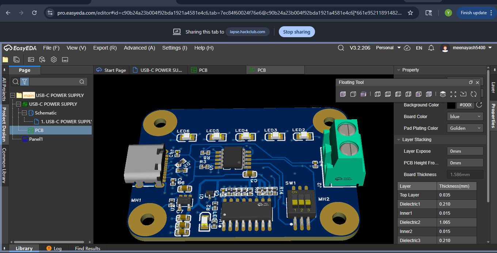
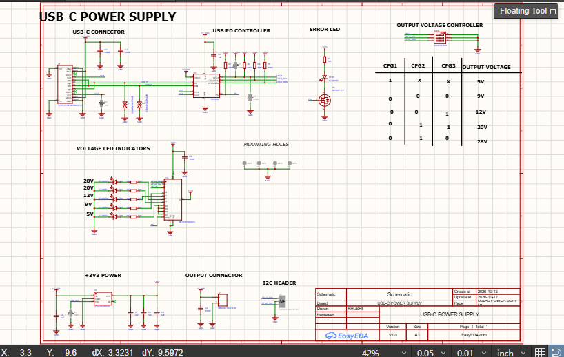
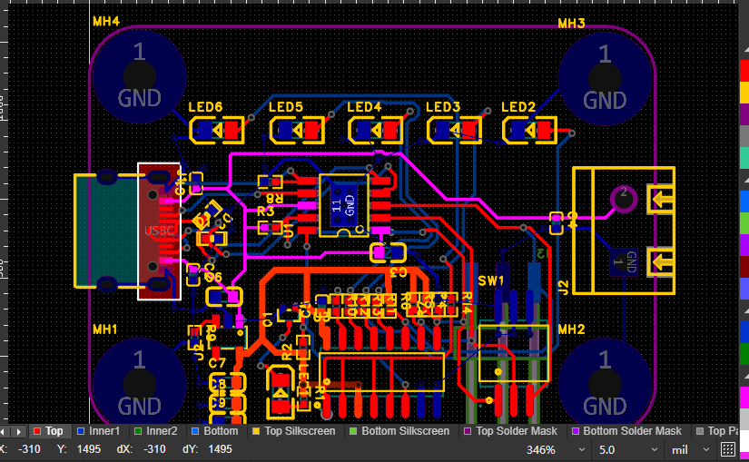

# USB-C Power Supply (5V / 9V / 12V / 20V / 28V)

A compact USB-C Power Delivery power supply that outputs **5V, 9V, 12V, 20V and 28V** from a USB-C charger. Useful as a bench supply.

## Demo Video

  [][https://youtu.be/Hs4IFvJVBb]

> Click the image to watch the demo.

## Images

### morning

### mid day

### night

## Features

- output: 5V, 9V, 12V, 20V, 28V
- USB-C Power Delivery negotiation
- Designed in EasyEDA Pro
- Full manufacturing files included (Gerber, BOM, 3D model)

## Important Notes

- **28V is a PD 3.1 EPR (Extended Power Range) mode.** To get 28V you need a charger that supports EPR **and** a 5A e-marked USB-C cable. With a normal charger or cable, 28V will not be available.
- The available output voltages and current depend on what your charger supports.

## Getting Started

1. Open `hardware/USB-C_POWER_SUPPLY.epro2` in EasyEDA Pro to view or edit the design.
2. To order the PCB, upload `gerber/gerber.zip` to a PCB manufacturer (JLCPCB, PCBWay, etc.).
3. Use the file in `bom/` to source the components.
4. Solder, then test with a current-limited load first.

## Safety Warning

nope nope 

## License

This project is licensed under the MIT License. See the [LICENSE](LICENSE) file for details.

## Author

**YOUR_NAME**
GitHub: [@meenayash5400-ux](https://github.com/YOUR_USERNAME)
